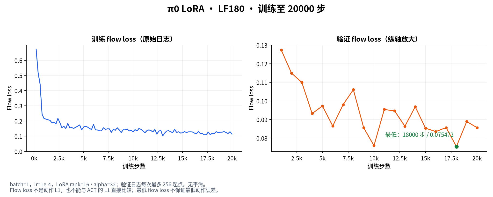
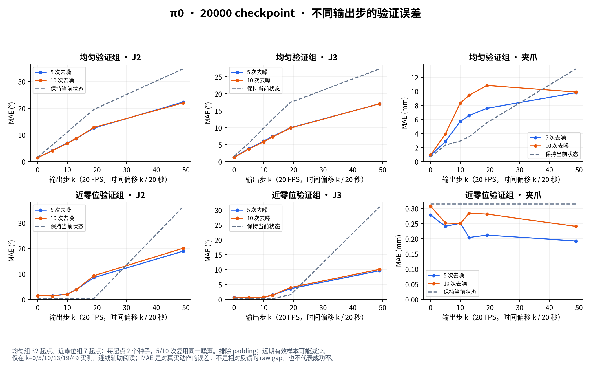
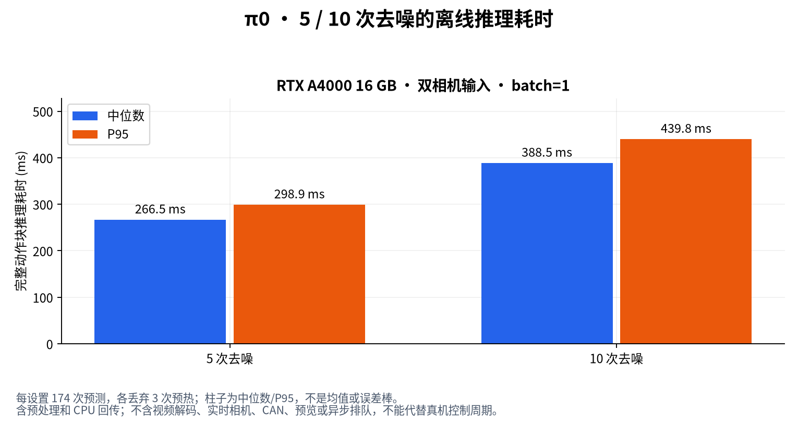
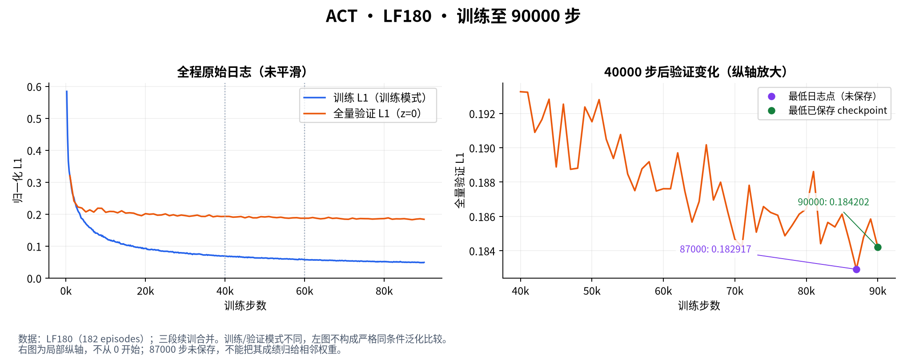
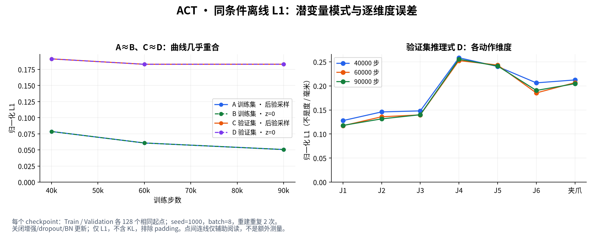

# 研究、实验与经验台账

最后整理：2026-10-19（补充原始数据合并记录；曲线仍来自此前实验，没有新增训练结果）。当前操作命令与参数含义见 [README.md](README.md)。本文件记录
我们用什么数据、怎样训练/测试、看到什么问题、查过什么、证据支持什么以及还缺什么。

## 当前状态与阅读顺序（2026-10-15）

先读本节和文末最新实验，再查历史章节。历史中的“当前/本轮”仅指该节记录日期，
不能当作今天的默认配置；操作方法以README及docs手册为准。

| 项目 | 最新证据/结论 | 状态 |
|---|---|---|
| 主从/手柄采集 | 当前使用自定义主从与DLS手柄；WeGo已移除，Placo为可选对照 | 保留功能及回归测试 |
| LF180数据 | 182 episodes、67588帧；早期27条仅是增长过程快照 | 已核对，不按目录名字推断数量 |
| ACT LF180续训 | 40000→60000→90000；全量验证0.193268→0.187614→0.184202 | 90000为已保存项中最低；真机成功率未统计 |
| ACT潜变量 | 90000抽样A≈B、C≈D；60000→90000验证推理L1基本不变 | 泛化改善有限，不归因于z=0切换 |
| π0 LoRA | 020000 adapter已在本机重载、离线评估；不是仍停留在云端准备阶段 | 已实现，非稳定闭环验收 |
| π0 5/10次去噪 | 348次配对预测；5次更快，关节误差没有整体明显恶化 | 离线结论，不等于真机通过 |
| π0异步执行 | 曾出现队列断供、切块J2/J3越界；离线未复现具体故障画面 | 待修调度/保存完整故障输入；不放宽保护 |
| 文档/代码整理 | 报告模块化、续训合并、默认值说明和历史索引更新 | 不改遥操、模型权重和控制数值 |

最新证据：

- [ACT 90000训练汇总](../artifacts/reports/act_training/act_lf180_90000_20261015.html)
- [ACT 90000潜变量对照](../artifacts/reports/act_latent/20261015_lf180_090000_sampled.html)
- [π0训练效果](../artifacts/reports/pi0_lora/pi0_lora_lf180_v1_20261014.html)
- [π0 5/10次去噪对照](../artifacts/reports/pi0_lora/pi0_denoising_5_vs_10_20261014.html)

这些工件位于Git忽略的artifacts中，只在保留相应产物的工作区可打开；报告可由当前入口重建。
不要因为HTML存在就认为真机通过，也不要因为报告缺失就把旧数字当成新复算结果。

### 图表阅读索引

图表由已有 JSON 报告生成，不是示意曲线；PNG 直接显示在本文中，SVG 用于放大。
图片保存在可随源码提交的 `docs/best_practice_assets/20261016/`，不依赖浏览器打开本地 HTML。

| 图表 | 要回答的问题 |
|---|---|
| [ACT loss：全程与后期](#图act-loss) | 续训到90000步，训练和验证分别改善多少？ |
| [ACT 潜变量与逐维度误差](#图act-潜变量) | 后验采样与z=0差异是否足以解释验证问题？ |
| [π0 flow loss](#图π0-loss) | 日志最低点在哪，最后权重是否最好？ |
| [π0 输出步误差](#图π0-输出步误差) | 近期/远期、均匀/近零位观测的误差有什么区别？ |
| [π0 推理耗时](#图π0-推理耗时) | 5/10次去噪在同一设备上差多少？ |

重建命令（在项目根目录、robotarm环境执行；只读取报告，不加载模型）：

```bash
python -m robotarm.modeling.reports.best_practice_figures
```

该命令重新生成这组带日期的图，不会自动切换到新训练；重复执行会覆盖同名图片。
输入路径与 SHA256 见[图表来源清单](best_practice_assets/20261016/manifest.json)。
新实验应另建日期目录，并同步更新图注、样本量和正文，避免将旧曲线当成新结果。

## 记录规则与证据位置

- 区分实测、操作者反馈、候选解释、已修复和待验证；没有任务成功统计时不写成功率。
- `healthy=true` 只是门控通过；`command_sent=true` 才表示下发模型目标，仍不等于任务成功。
- 抽样指标必须记录样本数；归一化 L1 与物理单位误差分开。不同数据集归一化统计不同，
  loss 的绝对值不直接代表跨数据集的真机精度。
- 完整训练参数以对应 `pretrained_model/train_config.json` 为准，策略结构见 `config.json`；
  当前 YAML 默认值不能用于推断过去的运行参数。
- 旧台账的数字保留在“历史实验”中，本轮未重新复算的条目明确标注；报告清理后不能冒充新测量。

| 证据 | 位置 |
|---|---|
| 训练配置和权重 | `artifacts/checkpoints/<run>/checkpoints/<step>/pretrained_model/` |
| 原始训练曲线 | `<run>/wandb/**/run-*.wandb`；用 training_report.read_history 读取 |
| 训练汇总 | `<run>/training_report/`，由 training-report 生成 |
| shadow / execute | `artifacts/logs/shadow/<run>_<step>_<hash12>[_execute].jsonl` |
| checkpoint 审批 | `artifacts/reports/runtime_approvals/` |
| 数据审查 | `artifacts/reports/dataset_quality/<dataset>.json` |
| 潜变量比较 | `artifacts/reports/act_latent/*.html` 和同名 JSON |
| open-loop | `artifacts/logs/trajectory_studio/<run_id>/` |
| 原始采集 | `data/raw/piper_raw/<session>/session.json`、`episodes/*/frames.npz` |
| 历史长报告 | [训练总结](../archive/model_training_summary.md)、[真机比较](../archive/real_robot_model_comparison.md) |

## 一、数据集与采集条件

### 1.1 2026-10-13 早期本地元数据快照（历史）

全部以下数据为 20 FPS。名称不是实际 episode 数，数量以 meta/info.json 为准。

| 代号 | data/lerobot 下目录 | Episodes | Frames | 相机 / 状态 |
|---|---|---:|---:|---|
| DUAL | piper_pick_cup_dual_camera | 88 | 23773 | global+wrist；两次 20260930 采集转换 |
| GLOBAL | piper_pick_cup_global_only | 88 | 23773 | 同源只保留 global，单相机消融 |
| LF30 | piper_pick_cup_dual_camera_30eps_20261012 | **31** | 13934 | 自定义软件主从，双相机 |
| GAME30 | piper_pick_cup_dual_camera_30eps_20261012_gamed | 30 | 16827 | 游戏手柄，双相机，四个 session |
| LF180 | piper_pick_cup_dual_camera_lf_180eps | **27** | 12189 | 当前元数据快照；不能按名字记成已完成 180 条 |

DUAL 原始来源：`20260930_171521_624643`、`20260930_174558_767967`。
旧审查记录为 78 保留 / 10 待复查；研究引用具体 run 中保存的入选列表，不能假设所有 run 都用相同列表。
当时LF180仅读取数量，没有效果结论；此后扩充到182条，最新ACT/π0结论见日期章节。

### 1.2 LF30 与 GAME30 采集实现

共同任务：Pick up the cup and place it in the target container。
共同相机：global D435 347522071736、wrist D405 260322272554，640×480，硬件彩色 30 FPS。
动作语义：绝对六关节 rad + 夹爪 m；state 为从臂实际反馈，action 为下发命令目标。
转换来源和 episode 对应关系保存在 meta/piper_conversion.json。

| 数据 | 原始 session | 条件 |
|---|---|---|
| LF30 | 20261012_114030_712739 | 自定义 software_leader_follower_move_js；控制 50 Hz，录制 20 FPS；主臂 can_leader1、从臂 can_follower1；同向映射、零偏移 |
| GAME30 | 20261012_145821_239298 | 手柄 Placo 后端 |
| GAME30 | 20261012_151734_645677 | 手柄 DLS 后端 |
| GAME30 | 20261012_152206_905471 | 手柄 DLS 后端 |
| GAME30 | 20261012_152659_864276 | 手柄 DLS 后端 |

手柄 session 元数据记录 control_rate=30、joint_step_deg=2.0、TCP 偏移 0.1425 m。
该 step 是启动元数据，不能还原录制时所有 LB/RB 档位或证明全部 episode 使用关节模式。
GAME30 混合了不同控制后端；尚未按后端单独评估，不认定它就是训练失败根因。

### 1.3 动作/反馈与时序调查（2026-10-13）

方法：读取转换后的 parquet，计算各帧绝对 action−state；六关节合并统计，以度显示。
夹爪以毫米显示。读取原始 frames.npz 的 timestamp/camera_frame_age 检查时序。

| 数据 | 关节差 P95 / P99 / Max | 夹爪差 P95 / P99 / Max |
|---|---|---|
| LF30 | 2.990° / 4.213° / 8.883° | 5.5 / 13.6 / 16.8 mm |
| GAME30 | 2.453° / 3.042° / 4.842° | 2.977 / 3.290 / 3.7 mm |

| 数据 | 帧间隔 P50 / P95 / P99 / Max | 每 episode 实际平均采样率 | 相机年龄 P95 / Max |
|---|---|---|---|
| LF30 | 40.85 / 60.72 / 61.01 / 67.08 ms | 19.98–20.00 Hz | 31.94 / 34.32 ms |
| GAME30 | 35.32 / 78.95 / 103.76 / 172.07 ms | 19.77–20.00 Hz | 31.82 / 46.66 ms |

结论：平均采样率符合 20 FPS，GAME30 的间隔抖动更大；这些统计不足以单独证明时序是主要训练问题。
最大 action−state 是采集分布描述，不自动等于应设置的运行门槛；原始跳变和实际物理状态还需审查。

### 1.4 历史数据数量（旧台账，当前目录未全部保留）

| 数据集 | Episodes / Frames | 原用途 |
|---|---|---|
| piper_pick_cup | 92 / 67133 | 早期 global 数据 |
| piper_pick_cup_v2 | 114 / 88932 | 清洗扩容 |
| piper_pick_cup_51eps | 51 / 32407 | 子集 |
| piper_pick_cup_lf_20260924 | 33 / 12483 | 主从采集 |
| piper_pick_cup_test_5eps | 5 / 2846 | 独立测试 |

## 二、训练配方与曲线

### 2.1 run 对照表

下列代号用于本文件，完整 run 名如下：

```text
R07     act_cup_ring_dual_20261007_v1
R08     act_cup_ring_dual_20261008_v1
R09     act_cup_global_20261009_v1
R12     act_cup_ring_dual_20261012_chunk50_control_v1
LF50    act_cup_ring_dual_20261012_chunk50_control_30eps_lf_v1
GAME50  act_cup_ring_dual_20261012_chunk50_control_30eps_gamed_v1
GAME100 act_cup_ring_dual_20261012_chunk100_control_30eps_gamed_v1
```

本轮直接核对保存的 train_config.json。均 eval_split=0.2、seed=1000、num_workers=4。
Train/Val 数是按单任务入选列表的尾部切分；打乱顺序以实际保存的 dataset.episodes 为准。

| Run | 数据 | 入选 / Train / Val | chunk / n_action_steps | Batch / Steps | save_freq / eval_steps | max_eval_samples | AMP |
|---|---|---|---|---|---|---:|---|
| R07 | DUAL | 86 / 68 / 18 | 50 / 5 | 8 / 50000 | 2000 / 2000 | 1024 | true |
| R08 | DUAL | 78 / 62 / 16 | 100 / 50 | 16 / 25000 | 2000 / 2000 | 1024 | true |
| R09 | GLOBAL | 78 / 62 / 16 | 100 / 50 | 16 / 25000 | 5000 / 2000 | 1024 | false |
| R12 | DUAL | 78 / 62 / 16 | 50 / 5 | 16 / 25000 | 1000 / 1000 | 0 | false |
| LF50 | LF30 | 31 / 24 / 7 | 50 / 5 | 16 / 25000 | 1000 / 1000 | 0 | false |
| GAME50 | GAME30 | 30 / 24 / 6 | 50 / 5 | 16 / 25000 | 1000 / 1000 | 0 | false |
| GAME100 | GAME30 | 30 / 24 / 6 | 100 / 20 | 16 / 30000 | 2000 / 1000 | 0 | false |

新三组共有配置：AdamW lr=1e−5、weight_decay=1e−4、grad_clip_norm=10，use_vae=true、kl_weight=10；
输入为 observation.state[7] + global/wrist 图像，训练目标 action[7]。其余网络和归一化设置查 config.json。
历史 ACT 配置包括 ResNet18、dim_model=512、8 heads、4 encoder/1 decoder 层、latent_dim=32；
SmolVLA 历史 lr=1e−4；Diffusion 历史 n_obs_steps=2、n_action_steps=8、lr=1e−4。
不要把历史策略默认值直接套到新的 run。

R12 的实验命令（不是新的最优配方）：

```bash
robotarm modeling train -- \
  data/lerobot/piper_pick_cup_dual_camera \
  artifacts/checkpoints/act_cup_ring_dual_20261012_chunk50_control_v1 act \
  --quality-filter --quality-shuffle-seed 1000 \
  --dataset.eval_split=0.2 --eval_steps=1000 --max_eval_samples=0 \
  --batch_size=16 --steps=25000 --save_freq=1000 --seed=1000 \
  --policy.chunk_size=50 --policy.n_action_steps=5
```

LF50/GAME50 用相应数据集和独立 run，其他上述关键训练参数相同。
GAME100 不只是 chunk 改为 100：steps=30000、n_action_steps=20、save_freq=2000 也不同，
因此真机对照并非严格单变量实验。

### 2.2 新三组的曲线调查

来源：对应 run 的 offline WandB，分别为 run-n4pvazfb.wandb、run-kd8nf80u.wandb、run-86igih0n.wandb。
第一验证点均为 step=1000，最后为本轮训练结束。

| Run | 第一次 / 最后 eval loss | 最低 eval loss / Step | 最后 train L1 | 最后 train total / KLD |
|---|---|---|---:|---|
| LF50 | 0.282613 / 0.218973 | 0.218973 / 25000 | 0.052448 | 0.055716 / 0.000327 |
| GAME50 | 0.211006 / 0.154613 | 0.153105 / 24000 | 0.038839 | 0.041804 / 0.000297 |
| GAME100 | 0.239516 / 0.195797 | 0.193374 / 29000 | 0.041015 | 0.043398 / 0.000238 |

从第一验证点到最后约下降 23%、27%、18%，不是完全未学习。验证误差仍明显较高。
GAME100 的 29000 权重未保存；已保存 checkpoint 最优为 28000（eval=0.194249）。
R09 旧台账曾写“训练中”，目前已有 25000 checkpoint，应记为已结束、任务成功率待记录。

### 2.3 划分和 loss 调查结论

- 当前调用 lerobot-train，由安装的 LeRobot 训练器定期 eval；不是独立 RobotArm 验证循环。
  核对了 lerobot/scripts/lerobot_train.py、datasets/factory.py、policies/act/modeling_act.py。
- 划分按任务取入选列表尾部 ceil(n×eval_split) 个 episode；quality-shuffle-seed 先打乱。
  默认顺序划分可能伴随采集时序差异，但不能把全部验证问题归因于此。
- 操作者反馈：试过顺序划分、随机划分、只用 global，相同类型的验证停滞仍出现。
  此反馈支持继续排查其他原因，没有为每次尝试补齐全部配对报告。
- 训练 VAE 用真实动作编码并随机采样潜变量，总 loss=L1+kl_weight×KL；验证 z=0，仅 L1。
  ACT 的 n_action_steps 不改变监督段和损失公式，chunk_size 会改变预测段长度。
- 日志 eval 为 batch loss 算术平均；A/B/C/D 工具按有效动作元素加权，不能要求两者逐位相等。
- online-policy 的限幅和 watchdog 不进入训练/验证 loss 的计算；它们能影响真机行为，
  不能解释离线验证 loss 为什么不下降。

训练产物管理也做过检查：当时 ACT 每个完整 checkpoint 约 591 MB，其中部署权重约198 MB、
恢复训练状态约394 MB。25k steps、save_freq=1000 会保留约25份，约14.4 GiB；
这是特定网络/优化器的容量记录，不是所有模型的固定大小。last 为软链，不另复制权重。
save/eval 错位时只能从已保存项选择 best；不同随机划分 seed 不是互斥的严格 k-fold。
清理部署不用的结果与历史查看入口时，应保留训练配置、源数据对应关系和用于结论的报告；
已归档的离线比较历史不再作为当前可运行功能。

## 三、ACT 潜变量对照：方法、结果和边界

目的：判断训练式重建与 z=0 推理是否存在主要差距。
A=Train 后验重建，B=Train z=0，C=Validation 后验重建，D=Validation z=0。
四组只计算整段 chunk 的归一化 L1，排除 padding，无 KL；禁用增强、dropout、BN 更新。
A/C 仅切换 ACT 顶层的潜变量分支，不递归调用 train()；保存/恢复原模块状态。
后验采样 seed=1000，每批 seed 加 repeat×1000003+batch_index，重复 3 次；B/D 各算一次。
工具复用 checkpoint 的预处理器及保存的划分，记录索引、batch size 和设备。

### 3.1 R12 / 023000

| 范围 | A | B | C | D | 证据 |
|---|---:|---:|---:|---:|---|
| 每划分 64 帧抽样 | 0.068831 | 0.068893 | 0.200922 | 0.200948 | [抽样 HTML](../artifacts/reports/act_latent/act_chunk50_023000_sampled.html) |
| 全量 Train 16304 / Val 3988 帧 | 0.073028 | 0.073088 | 0.207933 | 0.207943 | [全量 HTML](../artifacts/reports/act_latent/act_chunk50_023000_full.html) |

全量报告已在本地存在，本轮读取其 JSON 核对；不将先前的 CPU 抽样结果称为全量。

### 3.2 新三组（2026-10-13）

本轮 CPU 实际运行；每划分均匀抽样 64 帧、batch_size=4、repeats=3。

| Run / 权重 | A | B | C | D | 证据 |
|---|---:|---:|---:|---:|---|
| LF50 / 025000 | 0.063177 | 0.063198 | 0.217754 | 0.217755 | [HTML](../artifacts/reports/act_latent/20261013_lf50_025000_sampled.html) |
| GAME50 / 024000 | 0.053501 | 0.053593 | 0.150282 | 0.150296 | [HTML](../artifacts/reports/act_latent/20261013_game50_024000_sampled.html) |
| GAME100 / 028000 | 0.053682 | 0.053709 | 0.191177 | 0.191173 | [HTML](../artifacts/reports/act_latent/20261013_game100_028000_sampled.html) |

A≈B、C≈D，支持“潜变量模式差异不是当前主要误差来源”；同模型训练/验证差距更大，
支持泛化/分布问题方向，但不单凭该表确认过拟合根因。GAME100 没显示归一化验证优势；
长 chunk 覆盖不同时间跨度，损失任务本身也更难。两种采集方式的归一化尺度不同，
不能仅凭 LF50 与 GAME50 的绝对 loss 判采集方式优劣。

同数据、同归一化器的“未来整段动作始终预测为当前 state”基线，全量有效元素加权：
LF50 Train/Val=0.3555/0.3631；GAME50=0.2554/0.2642；GAME100=0.4194/0.4316。
模型并非完全没有学到未来变化；基线优于/劣于模型也不等于抓取成功/失败。
此基线全量、上表模型抽样，比较时需要保留样本范围差异。

## 四、真机异常现场与调查

### 4.1 LF50 / 020000：夹爪端点被误计为持续跟随限幅

命令为 online-policy --checkpoint LF50/020000/pretrained_model --execute，参数取当时 YAML。
现场：X 开始后约半秒暂停，`ACT target remained clamped for 11 ticks > 10`，后续 infer=0。
历史证据路径：`artifacts/logs/shadow/act_cup_ring_dual_20261012_chunk50_control_30eps_lf_v1_020000_3bb3484e6eb2_execute.jsonl`。
本次整理时该文件已不在本地，以下为此前记录，不表示重新复核了原始日志。

查了 raw_action、safe_action、state、act_hold_steps、动作队列和 envelope/clamp_step 的调用顺序。
第一周期有真实关节步长限幅；第 2～11 周期只有夹爪被修正：预测 −0.153371 mm，安全目标 0 mm。
原始边界检查允许 1 mm 容差，但持续限幅计数仍比较不可执行的原负值，因此同一动作永久保持，
不再消费队列，infer=0 表示保持旧动作而非持续重新预测。

已修复（2026-10-13）：容差内夹爪越界先修正为合法端点作为 tracking action；原始预测继续
用于边界/差值门控及日志。真实关节或夹爪步长/超前限幅仍保持并计数，超出容差仍暂停。
新增 act_tracking_action、act_tracking_clamped、act_gripper_boundary_corrected 遥测。
15 项专项安全测试通过；历史 11 条记录回放只有首条仍需真实跟随限幅。
**状态：代码/离线验证完成，修复后的真机效果待记录。** 未通过增大 hold 上限解决。

### 4.2 GAME50 / 020000：启动时原始关节差超过门槛

命令同上，换 GAME50/020000。两次试次均在第一条模型命令发送前被拦；command_sent 总数为 0。
历史证据路径：`artifacts/logs/shadow/act_cup_ring_dual_20261012_chunk50_control_30eps_gamed_v1_020000_ea7243c8f1ba_execute.jsonl`。
本次整理时该文件已不在本地，以下为此前记录，不表示重新复核了原始日志。

| 关节 | 启动反馈 | Trial 1 原始预测 | 差 |
|---|---:|---:|---:|
| J1 | 0.000° | −10.671° | 10.671° |
| J2 | 31.471° | 20.280° | 11.191° |
| J3 | −26.695° | −14.336° | 12.359° |
| J5 | 21.266° | 12.061° | 9.205° |

Trial 2 的最大差为 J3=12.60°。日志仅报告最大差的关节，不能认为只有 J3 超过 9°。
GAME30 的 episode 起点 J2 范围约 −0.14°～0.05°、J3 约 0.22°～0.45°；
与这次启动姿态差距大。GAME30 action−state 最大约 4.84°，本次预测差明显超过采集分布。

已确认：预测/启动姿态不一致，触发相对状态的动作差门槛；不是已经发送动作后的跟随滞后。
候选解释：起始输入偏离示教起点、模型泛化不足或场景差异。不能只靠角度日志确认具体图像原因，
也不能把“相对动作差过大”写成“超出机械物理限位”。该模型还预测约 −0.14 mm 夹爪值，
因此端点计数问题与关节差问题需要分别处理。

### 4.3 在线限制与采集限制的研究

旧 ACT 执行限制曾为关节 1°/1°、夹爪 1/2 mm；后按 DUAL 动作变化和 action−state 分布
将 ACT 默认调整为关节 step/lead=4°/6°、夹爪=8/16 mm；原始差门槛为 9°/18 mm。
这是运行安全参数，不是模型输出的数学约束，不进入 loss。

调查动作块消费：n_action_steps 决定在线执行节奏；限幅保持时冻结队列，不能将其理解成下一帧
又推理一次。只有先处理端点误计、真实跟随和启动分布，才有依据评估是否要调整门槛。
该次调查时 YAML 已有 n_action_steps:20；当时新两组 chunk50 真机日志为5。2026-10-15
整理时ACT YAML覆盖已为40，不能用任一较新的默认值倒推过去。
审批当前为 false，旧历史运行曾要求审批；所有状态按时间记录。

### 4.4 CAN 与角色调查

操作者已说明后续换 CAN 不是最初模型问题的原因，夹爪从 0 开始测试也未改善；
这些作为操作者反馈保留，不改写为已完成的受控消融。
2026-10-13 PC 只读 ip 查询：can_follower1=UP、can0=DOWN，没有 can_leader1。
尚未确认 can0 连接哪台臂，不根据名称直接重新分配角色。

## 五、遥操研究与修正

### 5.1 手柄 X 运动带 Z 偏移：控制点调查

现象：纯 X 输入时夹爪有下降倾向。检查 inputs、targets、runtime、SDK FK 和 URDF。
SDK FK 返回法兰，position-only 逆解允许腕部转动；法兰 Z 保持不能保证偏移后的夹爪点 Z 保持。
模型参考偏移为本地 Z 方向 4.5+138=142.5 mm，尚不是实际工具标定值。

实现：引入 TCP FK，保持未操作位置轴的目标，用实际 TCP 位置求解。
尝试过同时严格约束姿态的版本，部分测试不能收敛，未作为最终默认。
离线用采集关节状态、连续小步、理想反馈模拟检查；这只能验证运动学，不证明真机流畅。
当前保留可配置 tcp-offset-mm；姿态仍可自由变化，不能承诺避免所有奇异位形。

### 5.2 Placo 与自写 DLS 对照（2026-10-12～13）

动机：手柄早先已不流畅，操作者认为之前调好的手柄/PICO 效果退化；此现象在 TCP 修改前已出现。
PICO 使用 Placo，手柄使用纯 Python DLS；相同机械臂不代表两者控制策略相同。
接入可选 GamepadPlacoIK，用独立模型实例给 link6 操作坐标加 TCP 偏移，不改 PICO 模型文件。

离线对两个姿态测试六轴正反方向：24 个请求中 20 个接受；成功求解中位约 0.35 ms，
部分旋转因残差超过要求被拒。该数字仅为选定姿态的离线测试。
现场 Placo 日志：大多 ik_max=2～3 ms，work_max 常为 70～80 ms，实际 24～27 Hz，
即使 ik=0 仍有 45～75 ms 峰值。支持逆解外存在阻塞，未凭总计时确认唯一瓶颈。

检查到 Z/Yaw 先取主方向、运行时又优先 XYZ，可能先丢 Z、再丢 Yaw。
修为明确 Z 优先；给 Placo 加固定接合关节参考，暂停/模式切换后重取。
预览限至 10 FPS、末端输出限至 5 Hz，增加 input/control/record 分段计时，录制仍 20 FPS。
操作者反馈修后仍有问题，要求返回自写 DLS；因此默认/推荐回到 DLS，Placo 保留为可选对照。

DLS 优化：平移省去无关姿态矩阵计算、复用线搜索 FK；最多 32 迭代、重试共用 15 ms 软预算；
失败尝试 1/0.5/0.25 倍主动轴目标，保持轴和关节阈值不放宽。真实拒绝仍可能发生。
离线 XYZ 正反方向、每方向 40 周期共 240 周期在选定姿态下无拒绝；不代表全工作空间或真机验证。
小目标测试 90/90 均接受，旧/新中位 0.305/0.261 ms，P95=0.566/0.808 ms：
该次测试没有证明尾延迟改善，不能写成全面提速。

现场出现 iteration stalled 和 time budget exceeded。前者是无下降候选的通用错误，
不证明一定到奇异点或限位；后者来自新软预算，不是控制器故障。
候选解释包括不利构型、限位、参考姿态与末端目标冲突；需要失败时关节角、余量、残差才可确定。
手柄回零 speed 默认 5→10%，只影响 MOVE_J 回零，不改变 Jog 或夹爪回零速度。

### 5.3 主从臂对齐、回零与 WeGo 比较

自定义主从加入 l/a/f 对齐状态机，记录实际限速后 action；静止的事件驱动主臂输入不应被当作超时。
零力状态检查 155/156/157 和普通反馈择新，夹爪用 159；从臂反馈始终检查新鲜度。
旧 h 在主臂退出零力后用普通 MOVE_J，出现从臂回零、主臂已使能不动。
改用零力模式下固件 0x191 回零，检查新关节或已核对一致的电机位置反馈；失败保留 home-rx 原始摘要。
主臂固件回零速度由控制器决定，不能把从臂 10% 速度当作主臂速度。
回零急停后不再次使能，角色可能保留零力；独立 restore-piper-role 用 0x470 FC 切角色并提示重上电。

曾建立 WeGo 对照入口，参考 [lerobot_robot_piper](https://github.com/WeGo-Robotics/lerobot_robot_piper)，
版本 lerobot_robot_wego_piper=0.3.1、commit ed387ed9502d4fb0451488bfc9c763c8d60a1e07。
曾用 piper-doctor/piper-setup 配置角色；连接自动 parking，单位为关节 [-100,100]、夹爪 [0,100]。
包装层 max_relative_target=2.0 在快速拖动时触发裁剪；操作者反馈延迟/限制明显、自定义实现更流畅。
录制器保存原 leader action，而 follower send_action 内裁剪可能导致标签不同于实际下发目标。
这些是该对照路径的已检查行为，不代表所有上游版本都如此。
**当前 WeGo 采集入口已移除，README 不再提供运行命令；本段仅保留研究历史。**

### 5.4 PICO 研究记录

用 check_xr_frame.py 和 xr_monitor.py 比较房间坐标与基座坐标的位移，测试 yaw/mirror；
recenter 会改变房间朝向，单轴反向需镜像，不能仅旋转解决。
调整 scale、速度、每周期步长和 target lead；有效速度取两类限制的较小值。
固定 posture-anchor=engage 减少长时间操作的参考姿态漂移；保留 seed 作为旧行为对照。
PICO 录制入口当前禁用，B 用于安全使能；未用该路径制作本次 GAME30 数据。

## 六、π0 / π0.5 延迟与量化实验（2026-10-11）

方法：RTX A4000、CUDA BF16，读取 DUAL index=0 的同一帧；global→base、wrist→right_wrist，
缺失左腕用掩码；完整 50 步 chunk，warmup=1、正式 runs=5，CUDA 同步计时。
延迟包括预处理/任务 tokenize/生成/后处理，加载和视频解码另计；没有下发动作。

| 模型/模式 | 平均 chunk 延迟 | 重规划频率 | 常驻 / 峰值显存 | 原始报告 |
|---|---:|---:|---|---|
| π0.5 BF16 | 402.0 ms | 2.49 Hz | 8.71 / 8.87 GiB | [JSON](../artifacts/logs/pi05_offline/piper_dual_index0_bf16_a4000.json) |
| π0.5 INT8 weight-only，458 线性层 | 565.7 ms | 1.77 Hz | 4.39 / 4.59 GiB | [JSON](../artifacts/logs/pi05_offline/piper_dual_index0_int8wo_a4000.json) |
| π0 BF16，10 flow steps | 360.1 ms | 2.78 Hz | 8.28 GiB 常驻 | [JSON](../artifacts/logs/pi_offline/piper_dual_index0_pi0_bf16_a4000.json) |

π0 约 35.01 亿参数、π0.5 约 36.17 亿；π0 revision=6e245399ad403ccf02b8112b73cfdc2633068f38。
INT8 降常驻显存约 49.6%，本机 eager 路径延迟增加约 40.7%；显存够并不意味着计算/带宽足以满足20 Hz。
INT4 缺所需 mslk>=1.0 内核，未用不完整后端给出性能结果。
旧 global-only π0.5 试跑：加载140.4 s、warmup981.6 ms、稳态平均414.7 ms/2.41 Hz，
证据 [JSON](../artifacts/logs/pi05_offline/piper_global_index0_a4000.json)。

基础模型输出32维，未进行 Piper 动作适配；这些实验只比较延迟，不能证明哪种模型单臂任务更好。
显存、量化、动作块重规划频率和机械臂实际控制频率应分别记录；不能把50步输出直接视为可安全执行。

## 七、历史离线与运行验证（旧台账保留，本轮未重新复算）

### 7.1 离线结果

下列来源为旧记录的相对路径，部分工件已归档/清理；指标单位和抽样方式应回看原报告。

| 模型 | 数据/留出 | MAE / RMSE | hold_state MAE / 比值 | 历史来源 |
|---|---|---|---|---|
| ACT absolute 030000 | sim joint_absolute_100，ep80–99 | .0279 / .0550 | .0282 / .99 | logs/eval/act_sim_absolute_030000_holdout.json |
| ACT 015000 | piper_pick_cup_31eps | .0299 / .0671 | — | logs/act_pick_cup_act_holdout_256.json |
| ACT 015000 | piper_pick_cup ep21 | .0157 / .0286 | — | trajectory_studio/9fe352a91d9fc26a |
| ACT 015000 | test_5eps ep2 | .0229 / .0399 | — | trajectory_studio/9b578d1d9c1ae897 |
| Diffusion dp_full64 025000（原记录标签） | piper_pick_cup ep51–63 | .0164 / .0316 | .0060 / 2.75 | logs/eval/dp64_020000.json（标签与文件 step 不同，待核对） |

原结论：必须对照“保持当前状态”基线。比值<1说明在同一指标/样本上优于该基线，
不单独证明学会任务；总体 MAE 混合 rad/m 时还需逐维度检查。
操作者曾在 DUAL ep78 上跑逐帧输出步0和连续消费，认为动作整体可接受；
这是记录观测下的 open-loop 反馈，没有预测动作推进环境，不等于真机闭环成功率。

### 7.2 shadow 与执行遥测

maxloop、infP95、camP95 单位 ms。miss 为周期超时占比；这些属于控制健康，不是抓取成功率。

| checkpoint | shadow 样本 / 异常 | miss% / maxloop | infP95 / camP95 | 当时审批 | 当时 execute 记录 |
|---|---|---|---|---|---|
| R07/012000 | 1198 / 0 | 0 / 48.8 | 20.0 / 32.8 | 通过 | 2247帧，0异常 |
| R07/030000 | 1195 / 3 | .08 / 214.1 | 22.0 / 32.9 | 失败 | 未执行 |
| R07/050000 | 1198 / 0 | 0 / 42.7 | 5.2 / 32.8 | 通过 | 930帧，0异常 |
| R08/004000 | 1198 / 0 | 0 / 44.0 | 5.2 / 32.9 | 通过 | 53帧，仅试按，不能判任务效果 |
| R08/025000 | 1198 / 0 | 0 / 36.1 | 5.2 / 32.8 | 通过 | 221帧，151帧下发 |
| pick_cup 050000_run01 | 1518 / 0 | 0 / — | 4.4 / 32.2 | 未记录 | 原台账 real/ |
| pick_cup_v2_quality 050000 | 1198 / 0 | 0 / 20.2 | 4.3 / 32.3 | 通过 | 16102帧，0异常 |
| lf_20260924/040000 | 1198 / 0 | 0 / 18.0 | 4.1 / 31.7 | 通过 | 23393帧，0异常 |
| diffusion/025000 | 1189 / 0 | 0 / 42.6 | — / 31.6 | 通过 | 808帧，0异常，严重限幅37.6% |
| smolvla pick_up/050000 | 1196 / 0 | 0 / 28.1 | — / 32.2 | 通过 | 1035帧，1异常 |

### 7.3 历史失败与处理

| 现场 | 检查结果 | 当时处理/状态 |
|---|---|---|
| SmolVLA 同步20Hz | miss100%，maxloop418ms，同步推理约359ms | 改异步规划 |
| SmolVLA async10 run01 | 952/2391异常，规划供给跟不上 | 调 replan lead |
| SmolVLA async15 | 严重限幅100%，目标长期被钳制 | 调目标超前、消费15步，效果需另验 |
| Diffusion050000同步 | 43异常，推理1044–1058ms | 检查异步路径 |
| dp_v2异步 | 1192/1199异常，chunk1112ms、计划年龄1323ms | 未通过 |
| ACT双相机030000 | 3异常，首帧211ms，另31.2/30.3ms；原时限30ms | warmup、ACT时限60ms |

经验：warmup 与稳态/尖峰计时分别记录，不能对所有模型使用固定倍数放大时限。
异步仍需检查 underflow 和计划观测年龄。旧门控采用 miss比例≤0.5% + 最长单拍≤2周期，
依据历史正常 run 的 miss0～0.12% 与过载 run12.8～100%；不要写成出现一次超时就必然拒绝。
R08/025000旧执行曾有123ms单拍、占比.45%，该次无watchdog；不是未来运行一定安全的保证。

R08/R09 单/双相机来自配对数据，但 save_freq、AMP 不同，未补齐任务成功率；
不能宣称已完成严格单变量成功率对照。R07/R08 还改变 batch、steps、入选 episode 和 chunk。
审批启用时权重/运行参数更改后需重做，匹配 sha256 而非只匹配目录名。

## 八、2026-10-13 阶段性结论（历史，不代表最新状态）

### π0 LoRA 云端准备（2026-10-13，未实际训练）

新检查时 LF180 元数据已增长到182条、67588帧、20FPS；上文27条是此前快照，保留增长过程。
目标为单卡32 GB显存云服务器；本机缺少PEFT，执行沙箱没有可用CUDA。
新增独立 train-pi0-lora/check-pi0-lora，不修改现有ACT训练、遥操、online-policy或共享YAML。
依赖单独放在pi-lora extra。通过本机LeRobot实际参数解析及dry-run检查，尚未做云端前向/反向。

起步配方：pi0_base，BF16、梯度检查点、batch=1、rank=16、alpha=32、lr=1e-4，
chunk=50、n_action_steps=5、seed=1000、eval_split=.2，steps=20000，save/eval=1000，
验证上限256。20步smoke使用独立目录、最后保存/验证；之后重新加载adapter预测一帧。
参数不是已验证的最优配方或32 GB显存保证；云端实际显存、loss及重加载结果待补。

检查发现上游π0加载失败可能打印警告后返回初始化模型；独立driver将该情况转为错误，
并核对state/action投影权重，优化器创建前确认只有LoRA参数可训练及7维动作特征。
基础配置三相机/32维，训练时重建global/wrist与7维数据接口，使用本批统计，不修改原数据。
迁回本机通过显式base-checkpoint覆盖adapter记录的云端基础路径；保存的processors必须一起带回。
训练部分已准备，云端smoke和本机π0真机部署仍待验证/实现。

| 状态 | 项目 | 下一项可验证证据 |
|---|---|---|
| 已确认 | LF50 夹爪端点限幅计数错误 | 修复后真机日志，确认队列继续消费 |
| 已确认 | GAME50失败试次起点与示教起点不一致 | 匹配起始姿态/场景后的第一步逐维度误差 |
| 有支持、未定根因 | 新三组训练/验证差距大，潜变量差异小 | 全量、逐episode/逐关节、输出步0误差与门槛比例 |
| 待调查 | DLS局部停滞/时间预算拒绝 | 失败关节角、限位余量、残差和分段耗时 |
| 待人工记录 | 所有模型任务成功率 | 抓起并放入的成功次数/总试次，含起始条件 |
| 待核对 | LF180数据增长及质量 | 实际meta数量与审查记录，不能按目录名推断 |

已有的顺序/随机划分、单相机、chunk50/100尝试都未解决操作者报告的真机效果问题。
当前证据支持先把模型输入/启动分布、数据覆盖和执行逻辑分别检查，
不支持仅靠增加训练步数、改chunk或放宽watchdog来宣称问题解决。

## 2026-10-14：π0 LoRA 离线分析与异步运行实现

- run：`pi0_lora_lf180_v1`。保存配置确认 batch=1、20000 steps、lr=1e-4、
  rank16/alpha32、chunk50、n_action_steps5、BF16；训练/验证划分145/37 episodes，
  53903/13685 frames，验证日志每次最多256个起点。
- 解析本地 WandB 原始日志：1000步验证0.127415，18000步最低0.075472，
  20000步0.085630；累计采样20000个起点，日志epoch≈0.371。
- 对18000/20000 checkpoint，各在Train/Validation均匀采16个起点、重复2次，
  共128次完整50步chunk预测；固定配对seed，动作误差排除padding，使用保存的
  processors还原为deg/mm；不连接CAN或相机。报告：
  `artifacts/reports/pi0_lora/pi0_lora_lf180_v1_20261014.html`，同名JSON含预测明细。
- 验证归一化动作L1：18000=0.385379，20000=0.373610，排名不同于flow loss；
  样本太小，不判断显著性。20000验证J2输出0/19/49 MAE≈1.48/12.68/23.44deg；
  夹爪全chunk MAE11.79mm，保持当前宽度基线11.86mm。不能据此认定任务成功。
- 异步实现：π0接入已有planner，一次完整chunk推理；控制侧不访问模型。
  以最旧相机观测时间和20Hz对齐动作，跳过过期前缀，前20步耗尽时停止；
  提前12步请求下一块。限幅、raw gap、观测过期、队列耗尽和X重新启动门控保留。
  此处不是RTC训练/重叠块优化，也没有改善模型长时预测精度。
- 真实RTX A4000 16GB，用020000和已有数据验证工作线程：冷启动1200.9ms，
  第二次421.0ms，完整50×7输出，峰值显存8.428GiB。冷启动动作会跳过整个20步
  可用窗口，因此增加工作线程预热并丢弃其动作，随后用新相机/状态快照重新规划。
  PEFT0.21.2只安装至临时目录，不改变原robotarm环境。
- 相机窗口默认置顶、可调整大小；F/F11或双击全屏，Esc返回；在线窗口X/Y/S
  映射启动暂停/长按回零/电子急停，避免窗口获焦点时终端收不到按键。
- 单元测试覆盖模拟400ms推理、过期块、旧试次结果、基础权重/processor指纹，
  窗口全屏键、审批绑定；测试及GPU离线检查不代表真机安全或持续20Hz。
  当时真机首次shadow、循环频率和任务成功率尚待验证。后续已观察到断供和预测越界，
  见下一节；不能把这里的实现完成记为稳定闭环通过。

### 图：π0 loss



[放大 SVG](best_practice_assets/20261016/pi0_loss.svg) ·
[来源报告](../artifacts/reports/pi0_lora/pi0_lora_lf180_v1_20261014.html)

右图最低点为18000步，20000步有所回升；这里是 **flow loss**，不是动作L1。
验证每次最多256个起点，不能与ACT全量验证L1比较数值高低。
同一报告中18000/20000的抽样动作L1排名不同，说明选模型不能只看这一条曲线。

## 2026-10-14：π0 5次/10次去噪配对离线对照

- 起因：真机5次去噪时，切换动作块的输出13预测J2=-7.03°、J3=4.13°，
  超出当前软件边界J2[-2°,182°]、J3[-172°,2°]；该帧未发送。
  这些是部署软件边界，不是本次测量的机械硬限位。
- checkpoint：`pi0_lora_lf180_v1/checkpoints/020000/pretrained_model`；基础权重
  `artifacts/pretrained/pi0_base`。训练参数沿用上一节，没有重训或修改权重。
- 数据：LF180实际182 episodes、67588帧；恢复保存的145/37训练/验证episode划分。
  全量状态和动作的J2/J3均无软件越界。真实动作J2范围[0,141.701]°，
  J3范围[-132.932,0]°；因此这份数据不支持“起始采集动作本身越界”的解释。
- 方法：每个划分均匀取32起点，额外取frame_index≤20、J2/J3均在±3°的episode起点。
  训练组16个、验证组只有7个符合条件的独立episode。共87个起点，固定种子1000、1001003，
  每对5/10次显式复用同一噪声张量，交替先后顺序，共348次完整50步预测。
  双相机、batch1、BF16；关闭增强，推理输入不含真实未来动作，所有误差排除padding。
  均匀组/零位组分别统计；保持当前状态为基线，输出0/5/10/13/19/49。
- 实测RTX A4000：5次中位266.5ms、P95 298.9ms；10次中位388.5ms、P95 439.8ms；
  显存峰值8.428GiB。各预热3次，不计入统计；含预处理和CPU回传，不含视频解码、
  CAN、实时相机、预览或异步排队，因此不能代替真机延迟。
- 验证均匀组输出13：5/10次 J2 MAE=8.665/8.671°、J3=7.465/7.280°，
  夹爪6.559/9.435mm；没有发现改回10次就能明显改善关节预测。
  5次输出0 J2/J3 MAE=1.552/1.363°，输出19增至12.567/9.981°，远期误差仍大。
- 零位验证组输出13：5次J2 MAE=3.832°，保持当前状态仅0.312°；
  提示启动时序/动作幅度偏差，但不能直接判定是真机故障根因。
- 输出13验证抽样两种设置均未出现J2/J3越界，没有复现真机故障输入。
  只有2个种子与有限观测，不能推断实际场景不会越界。现有JSONL无相机图像，
  下一步应保存真实故障的原始双相机帧、状态和随机种子后离线复现。
  异步启动、连续供给与切块仍待单独修正；本次没有修改在线控制或安全门控。
- 报告：[HTML](../artifacts/reports/pi0_lora/pi0_denoising_5_vs_10_20261014.html)，
  同名JSON保存完整预测和checkpoint指纹，CSV保存逐步指标。
  现入口`robotarm modeling pi0-denoising-report`，旧`scripts/compare_pi0_denoising.py`兼容；
  复现命令见[π0手册](README.md#8-π0与π05离线训练测试)。
  配对bootstrap按起点重采样，先平均种子；同episode样本相关，区间仅作描述性参考。

### 图：π0 输出步误差



[放大 SVG](best_practice_assets/20261016/pi0_horizon_error.svg) ·
[来源报告](../artifacts/reports/pi0_lora/pi0_denoising_5_vs_10_20261014.html)

上排为32个均匀验证起点，下排为7个近零位验证起点，各配对2个种子。
横轴是输出步k，不是去噪次数；k=19对应观测之后0.95秒，k=49对应2.45秒。
5/10次关节误差相近，不能据此说“10次一定更准确”；近零位组应特别留意与保持状态基线的差距。
关节以度、夹爪以毫米分别作图；这些MAE不是watchdog的raw gap，不能直接套用其阈值。
排除padding后，各输出步有效样本可能不同；连线仅连接实际统计点。

### 图：π0 推理耗时



[放大 SVG](best_practice_assets/20261016/pi0_latency.svg) ·
[来源报告](../artifacts/reports/pi0_lora/pi0_denoising_5_vs_10_20261014.html)

5次去噪中位耗时约266.5ms，10次约388.5ms。两组各174次预测，预热不计入。
这能说明离线计算时间差异，不能证明异步队列不断供或真机达到20Hz；实时输入与调度开销未包含。

## 2026-10-15：ACT LF180续训至90000步

- run：`act_cup_ring_dual_20261013_chunk50_180eps_lf_v1`，不是π0模型。
  读取三份`run-7afhzfd5.wandb`，训练区间分别为200–40000、40200–60000、60200–90000。
  合并450条日志、90个验证点；`training_state/training_step.json`确认40000/60000/90000。
- 数据：LF180182条、67588帧；保存的episode打乱顺序一致，Train/Validation=145/37条，
  53903/13685帧。双相机global/wrist、7维绝对动作。
- 配方：batch16、seed1000、chunk50、n_action_steps20、AdamW lr1e-5、weight_decay1e-4、
  kl_weight10、AMP=false、无scheduler、无图像增强；eval每1000、save每2000、max_eval_samples=0。
  90000累计1440000起点、约26.71 epoch。没有把当前YAML中的40步覆盖记入训练参数。
- 续训：60000配置来自40000，90000配置来自60000；`resume=true`，不是从头训练。
  90000是总步数；最终阶段从60000追加30000步。

| 步数 | 全量验证loss | 最后日志训练L1 | 抽样训练推理B | 抽样验证推理D |
|---|---:|---:|---:|---:|
| 40000 | 0.193268 | 0.069690 | 0.078591 | 0.191342 |
| 60000 | 0.187614 | 0.057530 | 0.060788 | 0.182969 |
| 90000 | 0.184202 | 0.049367 | 0.050615 | 0.183021 |

- A/B/C/D GPU离线复算：各checkpoint每划分相同128起点、batch8、seed1000、重建重复2次，
  FP32，禁用增强/dropout/BN更新，只统计L1，排除padding并按有效元素加权。
  90000的A/B=0.050620/0.050615、C/D=0.183039/0.183021；潜变量模式差异很小。
  抽样不能替代全量日志，也不等于任务成功率。
- 40000→90000全量验证下降4.69%；60000→90000下降1.82%，抽样验证推理基本持平。
  支持“收益递减、泛化差距扩大”，但验证没有持续明显恶化，不断言严重过拟合。
- 最低日志点87000=0.182917，未保存该步；实际已保存项中90000最好。
  不能把相邻86000/88000套用87000的分数。
- [汇总报告](../artifacts/reports/act_training/act_lf180_90000_20261015.html)、
  [40000潜变量](../artifacts/reports/act_latent/20261015_lf180_040000_sampled.html)、
  [60000潜变量](../artifacts/reports/act_latent/20261015_lf180_060000_sampled.html)、
  [90000潜变量](../artifacts/reports/act_latent/20261015_lf180_090000_sampled.html)。
- 下一步：优先90000作候选、60000作同条件对照；先验证执行和具体失败类型，
  不以继续堆步数、改限位或引入RL代替故障调查。未执行真机、未修改训练参数。

### 图：ACT loss



[放大 SVG](best_practice_assets/20261016/act_loss.svg) ·
[来源报告](../artifacts/reports/act_training/act_lf180_90000_20261015.html)

左图保留全程原始日志，不平滑；虚线标出40000/60000续训分界。右图纵轴放大，只看40000步以后。
训练L1仍下降，但后期验证收益很小。训练模式与验证模式不同，严格同条件差距见下一张图。
最低日志点87000未保存；已有checkpoint里90000最好，不能用87000的数值标记88000。

### 图：ACT 潜变量



[放大 SVG](best_practice_assets/20261016/act_latent.svg) ·
[来源报告](../artifacts/reports/act_training/act_lf180_90000_20261015.html)

同一批Train/Validation各128个起点，seed=1000、batch=8、重建重复2次；只统计有效动作L1，不加KL。
左图A/B、C/D几乎重合，支持“本次潜变量模式切换不是主要误差来源”；不表示已找到泛化根因。
右图是归一化误差，不能把关节和夹爪的数值直接解释为物理误差大小，也不能换算成任务成功率。

## 2026-10-19：三个原始session合并（尚未训练）

需求是合成新的`piper_raw_v1`原始session，不是转换LeRobot；没有混入原来的LF180数据。

| 原始session | Complete episodes | Frames | 合并后编号 |
|---|---:|---:|---|
| `20261019_140239_223914` | 45 | 11368 | 0–44 |
| `20261019_143324_295798` | 47 | 10598 | 45–91 |
| `20261019_151443_922093` | 30 | 6821 | 92–121 |

- 输出：`data/raw/piper_raw/20261019_merged_122eps`；共122条、28787帧，约0.499GiB文件复制量。
- 相机：global D435 `347522071736`、wrist D405 `260322272554`，640×480，数据20FPS。
- 任务标签均为`Pick up the cup in different poses`；保留原文，未自动改成旧的抓取并放置任务。
  `complete`是录制状态，不是本次人工确认每条任务成功。
- 方法：`merge-piper-raw --execute`独立复制，重新编号目录和episode.json；视频不重编码，NPZ不改值。
  每个复制文件做SHA256校验；三个源目录保留，来源元数据/映射写入输出的`merge_manifest.json`。
- 验证：所有输入数组和视频头帧数/FPS/尺寸检查通过，输出122条、无未完成标记；297项回归测试通过。
  没有逐帧人工审查、LeRobot转换、训练或真机执行。
- 限制：相机序列号/格式/内参兼容不能证明外参或视角一致。需要根据采集批次与画面检查相机拆装影响，
  并按episode保留训练/验证隔离；不要把源session和本次合并副本同时加入训练，避免重复样本/泄漏。
- 当前合并不改`convert-piper-raw`、遥操或模型控制行为。可复用命令与保护规则见
  [采集手册](README.md#51-原始session合并)。

## 可复用经验与当前未完成项

- **区分指标**：flow loss、归一化L1、关节度/夹爪毫米误差、watchdog通过率、任务成功率不同。
- **先分离故障层级**：真实采集标签/输入分布、模型预测、时序调度、控制门控分别检查。
  训练/验证loss不经过online-policy限幅；调整门槛不能解释离线loss改善。
- **保留可复现对照**：同数据划分、同起点、同噪声/种子、同batch、同后处理；配对条件改变需记录。
- **别把程序跑完当通过**：shadow需看完整遥测；本次π0曾跑完但有断供和原始动作失败。
- **失败输入需完整留存**：JSONL角度不足以重建视觉模型输入，还需原图、任务文字、时间戳与随机种子。
- **先得到稳定基线再考虑RL**：当前尚无规范的闭环成功率统计，不能套用“50%–60%是模仿学习上限”。
  优先修执行、分类失败、补针对性的纠错示范；这不要求先接RL。
- **仍待完成**：π0启动排队/切块/持续供给、真实越界输入复现、ACT60000/90000配对闭环试次、
  失败恢复示范与任务成功率。以上未因本次目录整理而解决。
- **整理边界**：2026-10-15只收拢报告代码和操作文档、修正报告选择逻辑；
  现有数据/权重/报告未删，遥操/控制数值未改，测试作为回归保留。

## 新增记录模板

```markdown
### 日期 / 实验编号 / 状态

- 问题与假设：
- 数据集、原始session、episode数量、相机/装定、动作单位与语义：
- 训练run、完整命令、seed、入选列表、Train/Val划分：
- batch、steps、lr、chunk、n_action_steps、AMP、save/eval间隔、验证采样量：
- checkpoint step/sha256；运行CLI与实际生效参数：
- 方法：样本范围、重复次数、随机种子、归一化/物理单位、padding处理、基线：
- 观测：曲线、逐维度误差、耗时、command_sent、watchdog；人工任务成功x/y：
- 查过什么：代码函数、数据字段、报告、厂家文档；证据路径：
- 已确认原因 / 尚未验证的候选解释：
- 修改与验证：离线/真机分别记录，失败试次也保留：
- 结论及适用范围：
- 未完成事项和下一次对照条件：
```

## 从旧操作文档迁入的历史记录（2026-10-20整理，未复测）

以下为旧文档已有记录，不是本次新实验；原页未附完整原始日志，数字只作为历史线索，不能代替当前真机验收。

### PICO逆解与姿态参考

旧的 `--posture-anchor seed` 把正则目标设为上一周期命令，
只能抵抗变化、无法纠正累积漂移：离线往返测试（同一目标出去再原路返回、重复两轮）
中关节漂移为 1.22°→2.41°（逐轮累积），锚定接合姿势后为 0.006°，位置误差不变。
长时间操作时 `seed` 会让机械臂漂到与起始无关的构型，表现为"姿势越来越奇怪"。

离线对比（理想瞬时关节反馈，无真机动力学，目标在 1 秒内移动 30 mm）：弯曲姿态侧移误差由 22.14 mm 降至 0.03 mm，零位侧移由 26.05 mm 降至 12.62 mm。零位仍然受可操作性和关节速度约束。该对比同时包含限速与姿态权重调整，不代表真机已达到相同效果。测试未发送硬件命令。

### 仿真脚本固定回归

旧仿真手册记录：`force-pick-cup --episodes 20 --seed 20260905` 为19/20合格。仅用于历史对照，任务成功与数据合格仍需分别判断；本次未重新运行仿真。

### 2026-10-15代码整理范围

- 报告实现从scripts收拢到包内，抽取HTML组件，加入统一CLI和兼容壳。
- 合并全部WandB续训日志，推荐候选只使用有实际验证值的已保存checkpoint。
- ACT汇总报告移除绑定90000步/LF180的硬编码文字，读取实际配置与配对报告。
- 当时将操作手册拆分到docs；2026-10-20已重新合并到README，实验结论仍独立维护。
- 保留遥操、控制、安全阈值、训练入口及历史实验文件；未重新运行真机或训练。
- 没有发现仍需删除的旧viewer.html；不凭名称清理现有仿真viewer或Open-loop前端。
